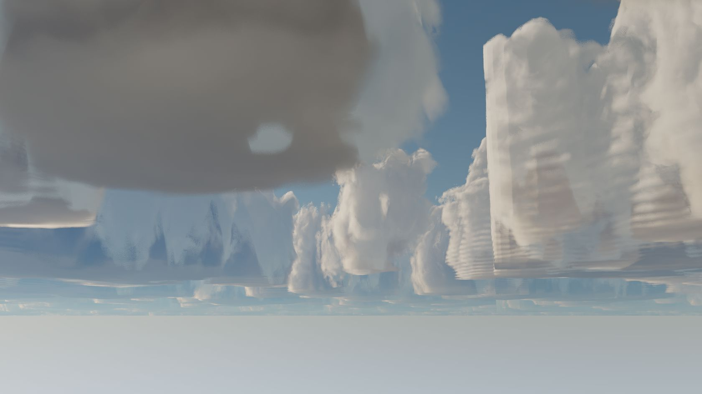

# Linked storm regions and straight cloud cuts — 2026-10-11

Status: source implemented; non-build checks passed. User C++/shader compilation
and visual/live acceptance remain pending. This supersedes the single-shell
`towering_cumulus` implementation, which the user found too stratiform.

## Correct visual evidence

The initial inspection caught the user's changed, cloud-disabled scene and was
discarded. After the user prepared the scene again, external IPC captured the image
below and `cloud_cut_before_2026_10_11.json` with the camera and settings. The image
shows a conspicuously straight vertical face on the right-hand cloud.



At capture: one generic layer, base 1100 m, thickness 7910 m, type 1, coverage 0.66,
cell period 4200 m, detail period 500 m, production RT with 128 steps. Cirrus was off.
No cloud/camera settings were changed. Capture was temporarily enabled and its prior
state restored. The image is the user's compiled baseline, not the new source.

Weather and noise samplers use REPEAT; the data are not clipped to a VDB box. This
rules out a simple clamp-to-edge sampler explanation, not every possible field bug.

## Traversal corrections

Production previously advanced by `max(segment_length * 0.5, distance_grown_dt)`
when the majorant was zero. The neighbourhood maximum only proves a segment of
`cloudSegmentLen` empty. At distance, `dt` can exceed that bound and skip cloud in
the next tile. The empty skip now stays within that certified segment. This is a
source-level correctness defect consistent with tile-like cuts; visual acceptance
is required to establish whether it explains the captured face completely.

The production marcher also used one work budget for all intervals and could exit
without processing the remaining ray, leaving its old T to expose clear sky. It now
reserves bounded work for later intervals and increases sample lengths near budget
exhaustion to complete each interval. A final coarse sample cannot reuse the empty
majorant proof beyond its support. Zero cheap-density samples no longer jump twice
the distance-grown step. The global budget stays `steps * 4`.

This tail is a bounded approximation: coarse completion can miss thin detail and
is not equivalent to adding high-resolution steps or unbiased reference tracking.
It prevents treating a work-budget exit as a completed high-quality march.

The old 200 km ray limit is also insufficient for tall clouds: on an Earth-size
planet a 12.5 km top has a horizon distance near 399 km. The cloud limit is now
1000 km. This is separate from the tile-skip defect. More distant sky can require
more work; production and reference hard budgets remain. Reference cap-hit paths
retain their documented conservative, dark-biased fallback.

## Three connected regions

`storm` and `towering_cumulus` now construct three adjacent, non-overlapping regions:

| Region | Altitude | Role | Noise period / detail period | Nominal extinction |
| --- | --- | --- | --- | --- |
| Base | 800–2400 m | 1 | 6000 / 450 m | 0.065 /m |
| Towers | 2400–9500 m | 2 | 3200 / 320 m | 0.045 /m |
| Anvil | 9500–12500 m | 3 | 5500 / 600 m | 0.022 /m |

All have formation group 1, matched directions and weather offsets. Group members
share the full vertical span and footprint period of the first enabled member.
The geometry uses continuous hashed column centres, variable column tops, a broader
base, narrower rising stems and outflow from the tallest heads. The three regions
sample the same skeleton instead of three unrelated noise fields. Density stays
inside its local weather/optical bound even at full coverage, so full weather cover
does not turn the column skeleton into a solid slab.

The base/tower/anvil roles also select different billow proportions and erosion
behavior. Shape height and shear use the group's global height, not a fresh height
origin for each region. Interior boundaries do not force a zero-density plane.
The underlying noise frequencies, extinction and optical modifiers remain regional:
this is a first connected storm model, not an already visually accepted cinematic
cumulonimbus. Regional noise/material changes can still require transition tuning.

The footprint evaluates a 3x3 set of integer-hashed cells without additional texture
reads. Its largest radius is contained in that neighbourhood: 0.70/0.85 < 1.25 cells,
the closest possible omitted centre. Support therefore does not truncate at the
enumeration cell edge. Added arithmetic and three active regions still cost more
than a single generic layer; unchanged texture-read count per density call is not
a total-performance guarantee. Grouped ambient occlusion samples the complete field
above/below the point, rather than treating each region as separately exposed to sky.

## Regional material and canonical operations

Layer JSON adds:

- `formation_role`: integer 0 generic, 1 storm base, 2 tower, 3 anvil.
- `formation_group`: integer 0 independent, 1..3 linked.
- `use_custom_material`: bool, activates local optical modifiers.
- `material`: the same validated CloudMaterial schema as the common material.

Controls are shared between World > Clouds and `[World] Clouds` in VDB. Formation
role/group and local material changes flow through the existing CloudState service,
serialization and validation; Python and IPC use the same layer patch path.

With local modifiers enabled, density, scattering coefficient and RGB scattering
colour multiply their common values; absorption coefficients and emission sources
add. A local anisotropy override replaces the common phase override. Thus the common
material remains an effective master even when all three regions have local optics.
Master density zero disables all regions and cirrus. Stored local colours/ranges use
the same validation as common optics; malformed or non-finite input is rejected.
Emission composition uses source RGB internally without creating a second authored
state. RGB scattering is still an albedo tint; absorption is achromatic.

Presets give the base more density, slight absorption and a cooler albedo tint;
towers are whiter and the anvil is lighter. Selecting either new preset replaces
the region layout/modifiers but preserves the common material and quality, as before.
Existing projects default to generic role, independent group and disabled modifiers.
Local material floats interpolate through world cloud keyframes; roles, groups and
modifier enable flags switch at the key boundary. Save/load uses CloudState JSON.

Example Python:

```python
rt.world.apply_cloud_preset("storm")
rt.world.set_clouds(layers=[{}, {
    "use_custom_material": True,
    "material": {"density_multiplier": 0.8, "absorption_coefficient": 0.02},
}])
```

External equivalent:

```python
ipc.call("world.apply_cloud_preset", preset="storm")
ipc.call("world.set_clouds", layers=[{}, {
    "use_custom_material": True,
    "material": {"density_multiplier": 0.8, "absorption_coefficient": 0.02},
}])
```

Both production and reference transport consume each hit region's effective albedo,
emission and phase. Cirrus retains the common material and its existing thin-sheet
model. Frozen OptiX/CPU legacy clouds do not implement the new linked-region model.
The IPC discovery overlay was updated alongside the generated declaration so a
future descriptor regeneration retains the new schema description.

## User build and acceptance

The GPU layer is now 112 bytes; the complete packet is **480 bytes**. Build C++ and
all consuming cloud shaders together (`cloud_sample`, `cloud_raster`, `cloud_shadow`,
`miss`, `closesthit`, `sphere_closesthit`) and restart with matching binaries. This
increment does not change baked noise generation; the normal full shader workflow
is also valid. No project build, shader compilation or app launch was run by Codex.

1. First keep the captured generic scene/camera/settings to compare the straight
   face against the baseline. Rotate the camera as the user did; inspect several
   repeated cuts, distant horizon and coverage 0.66 to higher cover. This isolates
   traversal fixes from the new formation model.
2. Then reapply `storm` or `towering_cumulus` to obtain three linked regions. Inspect
   foundations, rising columns, varying tops and the spreading cap. Check region
   boundaries, not only the distant silhouette. The old single-layer saved scene is
   not automatically rewritten as the new preset.
3. Edit regional optics in World/VDB; verify common density/scatter still affect all
   regions. Check local phase overrides in both transport modes, shadows, save/open
   and keyframe behavior. Mismatched directions/group IDs intentionally misalign
   regions; the preset starts aligned.
4. `python scripts/test/check_cloud_shape_contracts.py`: non-build consumer, packet,
   material-path and bounded-empty-skip audits. Python probe syntax, source brace/
   whitespace checks, the footprint support bound and far-horizon arithmetic were
   also checked. These do not compile C++/GLSL or prove the captured face is fixed.
5. After building, `python scripts/test/rt_test_cloud_regions_ipc.py` checks the new
   schema without edits. `--apply` temporarily applies storm, checks connected
   region definitions, per-region GPU density scaling, detail bounds, master zero
   and atomic rejection, then restores original cloud settings in `finally`.
   Accumulation restarts. Run externally, not in the embedded workspace; optionally
   repeat with `--backend render` for the other Vulkan role.
6. Compare fresh completed-sample cost. The added storm arithmetic, three layers,
   longer ray limit and corrected skipping may increase work. Performance and
   cinematic lighting remain separate acceptance tasks.
